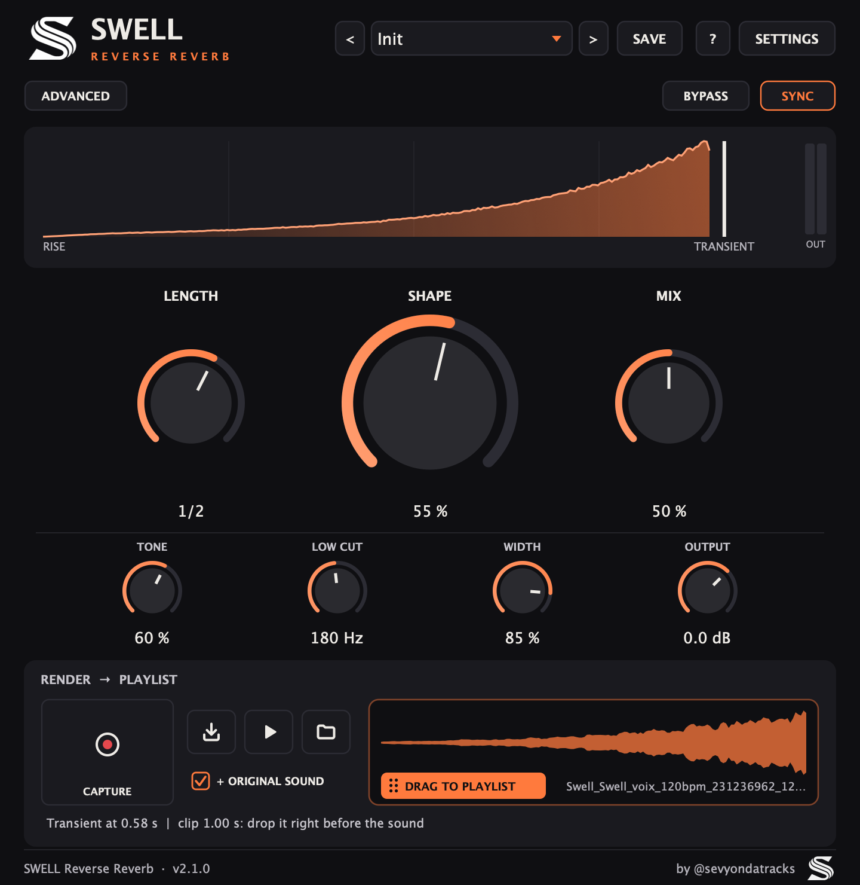
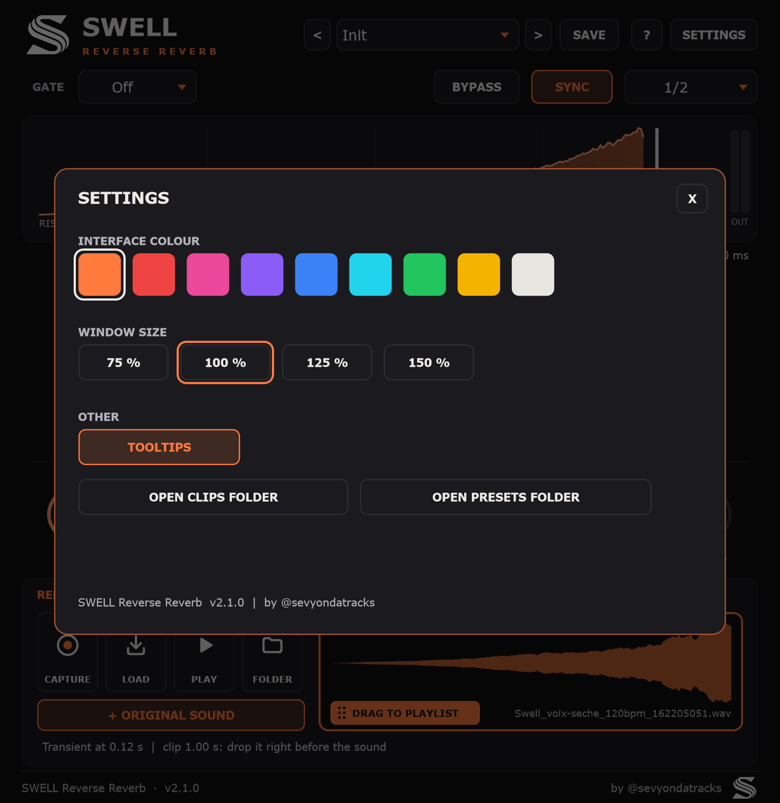
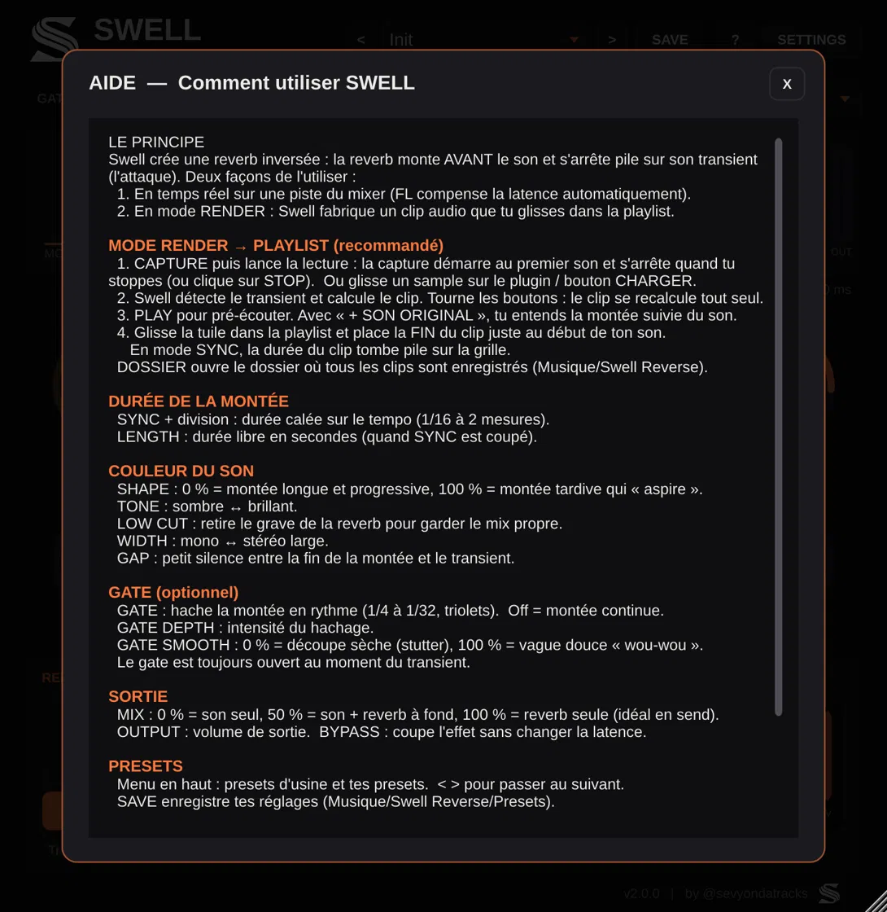

# SWELL — Reverse Reverb (VST3 / AU)  ·  v2.1

*by @sevyondatracks*

Effet de reverb inversée : la reverb **monte avant** le son et se termine **pile sur le transient**
(snare, vocal, perc…), sans avoir à bouncer/inverser/recaler à la main dans FL Studio.

<p align="center">
  
</p>

| Settings | Aide intégrée |
|---|---|
|  |  |

## Comment ça marche

Le plugin convolue le signal avec une réponse impulsionnelle de reverb **inversée dans le temps**.
Il déclare sa latence à FL Studio (= durée de la montée), et FL la compense automatiquement :
la montée arrive donc *avant* la note, en temps réel, sur n'importe quelle piste.

## Réglages

| Bouton | Rôle |
|---|---|
| **LENGTH** | Durée de la montée. SYNC coupé : en secondes (0,1 → 4 s). SYNC allumé : le même bouton choisit une valeur de note calée sur le tempo (1/16 → 2 mesures, 1/2 par défaut) |
| **SHAPE** | 0 % = montée longue et progressive, 100 % = montée tardive qui "aspire" d'un coup |
| **TONE** | Sombre ↔ brillant |
| **LOW CUT** | Coupe le bas de la reverb (garde les basses propres) |
| **WIDTH** | Mono ↔ stéréo large |
| **MIX** | 0 % = dry, 50 % = dry + reverb à fond, 100 % = reverb seule |
| **OUTPUT** | Volume de sortie |

## ADVANCED : Gap + gate rythmique (optionnel)

Le bouton **ADVANCED** (en haut à gauche) remplace la rangée du bas par ces réglages.
Quand le gate est actif, le bouton l'indique même fermé (ex. « ADVANCED · GATE 1/16 »).

| Réglage | Rôle |
|---|---|
| **GAP** | Petit silence entre la fin de la montée et le transient (0–500 ms) |
| **GATE** | Off, 1/4, 1/8, 1/8T, 1/16, 1/16T, 1/32 : hache la montée en rythme ("wou-wou-wou") |
| **GATE DEPTH** | Intensité du hachage (0 % = aucun effet). Visible quand le gate est actif |
| **GATE SMOOTH** | 0 % = découpe sèche (stutter), 100 % = vague douce |

Le gate est calé sur le tempo et toujours **ouvert pile au transient**.

## Mode Render → Playlist

1. **CAPTURE** : arme la capture, lance la lecture dans FL ; la capture démarre au premier son
   et s'arrête quand tu stoppes la lecture (ou re-clic sur STOP).
   **ou** glisse un sample (WAV, AIFF, MP3, FLAC…) sur le plugin / bouton **LOAD**.
2. Swell détecte le transient et calcule le clip de reverse reverb (avec tes réglages, gate compris).
3. **Glisse la tuile orange dans la playlist** de FL : la fin du clip = le transient.
   Place le clip juste avant ton son (en mode Sync, sa durée tombe pile sur la grille).

**PLAY** pré-écoute le clip ; avec **+ ORIGINAL SOUND**, tu entends la montée suivie du son.

Le clip se **met à jour tout seul** quand tu tournes un bouton (gate, length, tone…) :
règle à l'oreille, puis glisse la tuile quand le son te plaît.

Les clips sont aussi enregistrés dans *Musique/Swell Reverse* (bouton **FOLDER**).

## Presets

Menu en haut à droite : presets d'usine (Vocal Swell, Snare Suck, Afro Perc Wou, Stutter 1/16…)
et **SAVE** pour tes propres presets, rangés dans *Musique/Swell Reverse/Presets*.

## Interface

- **?** : aide intégrée (à quoi sert chaque élément, mode d'emploi).
- **SETTINGS** : couleur de l'interface (9 couleurs), taille de la fenêtre (75–150 %), infobulles.
  La fenêtre est aussi redimensionnable par le coin en bas à droite.
- Double-clic sur un bouton = valeur par défaut · Cmd + glisser = réglage fin.
- **BYPASS** : coupe l'effet sans changer la latence (relié au bypass de FL).
- Vumètre de sortie (OUT) à droite de la courbe.

## Installer sur Mac

### Option A — compilation automatique sur GitHub (sans rien installer)
1. Crée un dépôt GitHub (privé si tu veux) et pousse ce dossier dedans.
2. Onglet **Actions** → le workflow *Build macOS* se lance tout seul (~10 min).
3. Télécharge l'artifact **SwellReverse-mac** : il contient
   - `SwellReverse-2.0.0.pkg` : installateur (double-clic ; plugin non signé Apple, donc
     clic droit → Ouvrir la première fois), installe pour tous les utilisateurs ;
   - `SwellReverse-2.0.0-mac.zip` : installation manuelle avec `bash install_mac.sh`.
   N'utilise qu'une des deux méthodes pour éviter d'avoir le plugin en double.

### Option B — compiler sur ton Mac
```bash
xcode-select --install      # une seule fois
brew install cmake          # une seule fois
bash scripts/build_mac.sh   # compile + installe
```

### Dans FL Studio
*Options → Manage plugins → Find installed plugins*, puis cherche **Swell Reverse** (fabricant *Swell-audio*).

## Conseils d'utilisation
- **Sur une piste** (vocal, snare, perc) : MIX à 50 %.
- **Sur un send/bus** : MIX à 100 %, et dose avec le niveau d'envoi.
- Si tu changes la durée (ou le tempo en mode SYNC), la latence change : FL peut demander
  de relancer la lecture pour se recaler.
- Pour automatiser l'effet sur un seul mot ou un seul coup : mets-le sur un send et automatise l'envoi.

## Notes
- Formats : VST3 + AU, binaire universel (Apple Silicon + Intel), macOS 10.13+.
- Basé sur JUCE 8 (licence AGPLv3 ou commerciale) : libre pour ton usage perso ;
  pour vendre/distribuer le plugin, il faudra une licence JUCE adaptée.
- `Tests/RenderTest.cpp` : banc de test hors-ligne qui vérifie que la montée culmine sur le transient.

## Historique
- **2.0** : pré-écoute, settings (couleur, taille, infobulles), aide intégrée, bypass, vumètre,
  presets < >, fenêtre redimensionnable, installateur .pkg.
- **1.2** : re-rendu automatique du clip quand un réglage change.
- **1.1** : mode Render → Playlist, gate rythmique, presets, logo.
- **1.0** : reverse reverb temps réel.
